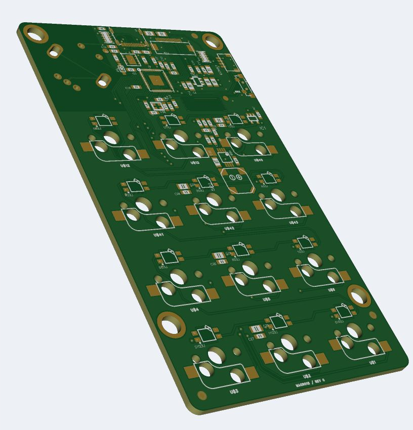
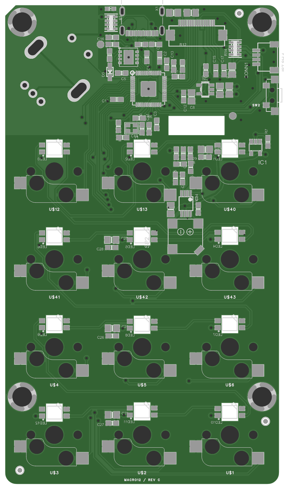
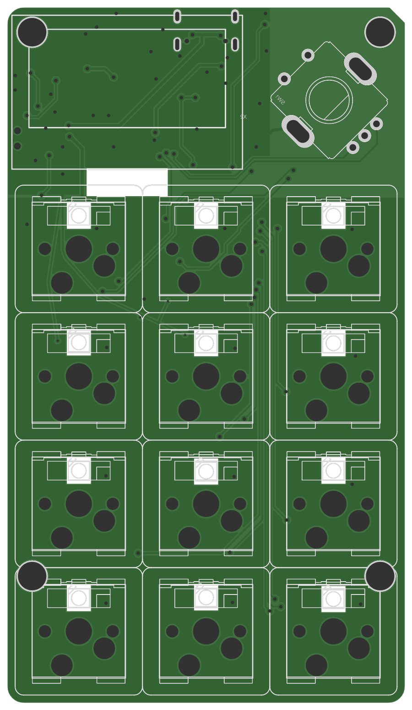

# MACRO12 RP2040 macro pad for EasyEDA Pro

An editable EasyEDA Pro adaptation of the Adafruit MacroPad RP2040 Rev D: 12 MX-compatible hot-swap keys in a 3-column by 4-row layout, onboard RP2040, and USB-C.

Rev C prototype PCB in EasyEDA Pro's native 3D preview. This is a bare-board render; the project has no component models, so switches, keycaps and electronics are not shown. Solder-mask and pad colors are illustrative. Physical assembly and testing remain pending.

**Rev C is released for first-article bare-board fabrication with the specified manufacturing and assembly constraints.** Native electrical DRC and schematic comparison pass; independent checks confirm all 76 nets, 338 physical pads and 171 drilled features. Nine intentional mechanical overlap findings remain documented individually in the [mechanical review](docs/mechanical-review.md). No physical board has been assembled or powered.

Download the [fabrication ZIP](fabrication/MACRO12-RevC-Gerber.zip) and read the [fabrication settings](docs/fabrication-notes.md) before ordering. The 1.6 mm board, precision LED milling and OLED/mounting controls are part of the design.

 

These previews are rendered from the released manufacturing data.

## Hardware

| Item | Design |
| --- | --- |
| Keys | 12, 19.05 mm pitch, MX-compatible hot-swap sockets |
| Controller | Onboard RP2040 with external flash |
| USB | HRO TYPE-C-31-M-12 USB-C connector |
| Encoder | Bourns PEC11R-4215F-S0024 with push switch |
| Board | 59.69 x 104.14 mm, two copper layers |
| Retained upstream features | 12 reverse-mount RGB LEDs, 16-pin folding OLED panel, speaker/amplifier, STEMMA QT |

The keys connect individually to GPIO1 through GPIO12; they are not a matrix. The electronic circuit and pin assignments come from the upstream Adafruit Rev D source. [QMK firmware with VIA support](firmware/README.md) provides four layers, remappable keys and encoder, RGB effects, and OLED status. Physical firmware testing remains pending.

## Open and edit

Import [MACRO12-RevC.epro](hardware/easyeda/MACRO12-RevC.epro) in EasyEDA Pro using **File > Import > EasyEDA (Professional)**. The archive includes the two schematic sheets, PCB, symbols, and footprints. Preserve the supplied footprints when importing; automatic footprint reassociation can change the design.

The EasyEDA project is the revised canonical design. The EAGLE files in `hardware/upstream/` are the unmodified upstream Rev D reference and do not contain the revised routing or Rev C footprint corrections. Earlier Rev B RC1 exports are superseded.

## Files

- [`hardware/easyeda/`](hardware/easyeda/): editable revised project.
- [`firmware/`](firmware/): QMK source, VIA definition, build workflow, flashing instructions, and first-article checks.
- [`fabrication/`](fabrication/): reviewed Gerber/Excellon ZIP and its ten unmodified manufacturing files.
- [`hardware/upstream/`](hardware/upstream/): original Rev D board and schematic, full upstream README, license, and its referenced product image.
- [`bom/`](bom/): reference BOM with Rev C part selections and retained upstream metadata. This is not an assembly-approved BOM or placement file.
- [`docs/release-validation.md`](docs/release-validation.md): completed checks, documented exceptions, and prototype validation limits.
- [`docs/mechanical-review.md`](docs/mechanical-review.md): drawing review, footprint corrections, and nine individual DRC dispositions.
- [`docs/assembly.md`](docs/assembly.md): required mounting and OLED-insulation controls.
- [`docs/fabrication-notes.md`](docs/fabrication-notes.md): board, milling, and plated-slot requirements.
- [`docs/modifications.md`](docs/modifications.md): changes from the upstream hardware.
- [`docs/checksums.sha256`](docs/checksums.sha256): file integrity hashes for the published snapshot.

## Attribution and license

Derived from [Adafruit MacroPad RP2040 PCB](https://github.com/adafruit/Adafruit-MacroPad-RP2040-PCB), designed by Limor Fried/Ladyada for Adafruit Industries, at commit `fdd7f2cb3bc2b3c7a9c0765780387647ea872141`.

The hardware design and modifications are distributed under **Creative Commons Attribution-ShareAlike 3.0 Unported**; see [LICENSE](LICENSE). The original [upstream README](hardware/upstream/README.md) is included in full as required by its redistribution notice. Hardware documentation uses the same license. Firmware, its documentation and tooling use **GPL-2.0-or-later**; see [firmware licensing](firmware/README.md#license-and-source). Adafruit and Raspberry Pi names identify the upstream design and component platform; this adaptation is not an official Adafruit product.
