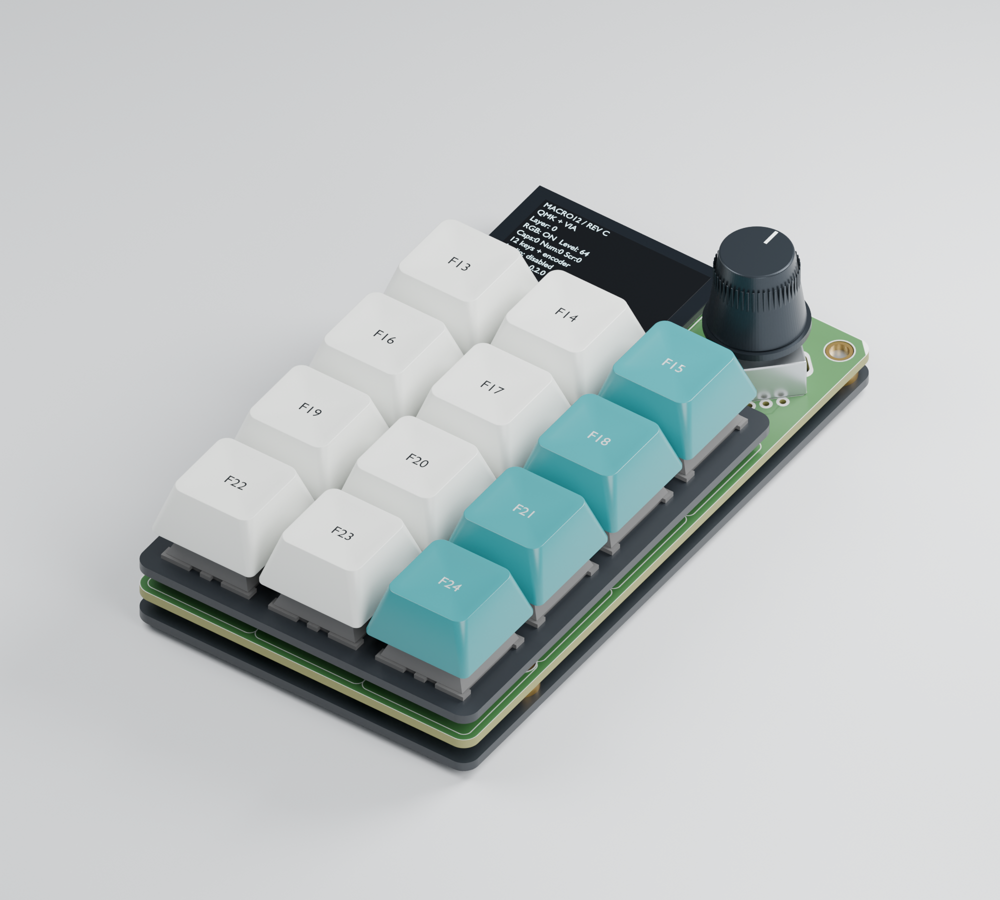

# Assembled Rev C visualization



Open [MACRO12-RevC-assembled.blend](MACRO12-RevC-assembled.blend) in Blender to inspect or change the camera, materials and individual parts. The scene uses millimetres and includes packed PCB textures. This is a CAD visualization, not a photograph or a verified mechanical assembly.

## What the image represents

- The PCB outline, 1.6 mm thickness, 171 drilled features, 13 routed apertures, component positions and surface artwork come from the released MACRO12 Rev C design. The user-facing side is the native bottom side: OLED left, encoder right.
- Official Adafruit CAD supplies the twelve MX switches, hot-swap sockets, switch plate, backplate plan geometry and many electronic bodies. The source assembly predates the electrical design used here, so it is corrected using [alignment.json](alignment.json): moved parts are repositioned, obsolete IC2 and unpopulated R9 are removed, and six new electronic parts receive representative package bodies.
- The encoder is rebuilt with the selected Bourns part's 15 mm shaft length. The 1.4 mm folding OLED sits on a 0.5 mm insulating spacer. Mounts use the specified 3 mm shoulder and M3 x 5 screw stack, with screw tips recessed below the user face.
- Keycap shape, teal/white colors, F13–F24 legends, knob finish, and simulated OLED content are illustrative choices. The legends and display text follow the included default/VIA firmware. Lighting does not represent measured LED output.
- Electronic meshes are visual package references, not certified manufacturer solids for every selected MPN. The simplified encoder, mounting parts and six added packages omit internal construction. Mechanical fit, solder clearance, optical behavior and physical operation still require first-article verification; see the [assembly controls](../../docs/assembly.md).

The native EasyEDA project remains the manufacturing source. This scene does not add component-model bindings to that project or replace its DRC/CAM reports.

## Reproduce the render

From the repository root, with Blender 5.2 installed:

```sh
blender -b --python hardware/3d/render_assembly.py -- --output work/assembled-render
```

Add `--preview` after the final `--` for a smaller 32-sample render. The default is 2000 x 1800 pixels and 128 Cycles samples. The script uses an available OptiX GPU, with CPU fallback, and produces both the PNG and editable `.blend` scene. The preconverted mesh archive is included, so no STEP converter is needed to render.

To regenerate the source meshes, install `cadquery-ocp==8.0.1.1.0` and run:

```sh
python hardware/3d/convert_step.py "hardware/3d/source/5128 MacroPad RP2040-Assembly.step" work/macropad-assembly.json
```

The source conversion preserves occurrence transforms, component names, face colors and millimetres. Tessellation uses 0.05 mm linear deviation and 0.3 radian angular deviation. The gzip archive contains the original converted geometry; Rev C corrections are applied by the renderer, not baked into the source CAD.

## Sources and licenses

The [official assembly STEP](<source/5128 MacroPad RP2040-Assembly.step>) is from [Adafruit_CAD_Parts at commit c128bce](https://github.com/adafruit/Adafruit_CAD_Parts/blob/c128bceb1f96b6ea8b68f250bda986ba85da24ea/5128%20MacroPad%20RP2040%20Kit/5128%20MacroPad%20RP2040-Assembly.step), under its original [MIT license](source/LICENSE). Its SHA-256 is `ad7130be64dcca0e5d728a626bff307b373cc3edb4621b8603e5e50ee360753d`. Converted Adafruit meshes retain that license and attribution.

The MACRO12 board geometry/artwork, this document, rendered image and combined Blender scene are distributed under the repository's [CC BY-SA 3.0 license](../../LICENSE), with the Adafruit CAD notice retained for incorporated meshes. The renderer and converter code use [MIT](LICENSE-MIT). Cosmetic keycaps and knob were generated procedurally; no product photograph or AI-generated image was used.

Dimensional references: [Bourns PEC11R drawing](https://www.bourns.com/docs/product-datasheets/pec11r.pdf), [folding OLED drawing](https://cdn-learn.adafruit.com/assets/assets/000/103/268/original/1.3inch_16pin_ZJY130-2864KSWLG22_VER_B.pdf), [Adafruit 4207 nut](https://www.adafruit.com/product/4207), [450-BA761 knob drawing](https://cdn-shop.adafruit.com/datasheets/EPD-200732.pdf), and [official kit assembly guide](https://learn.adafruit.com/adafruit-macropad-rp2040/macropad-assembly).
